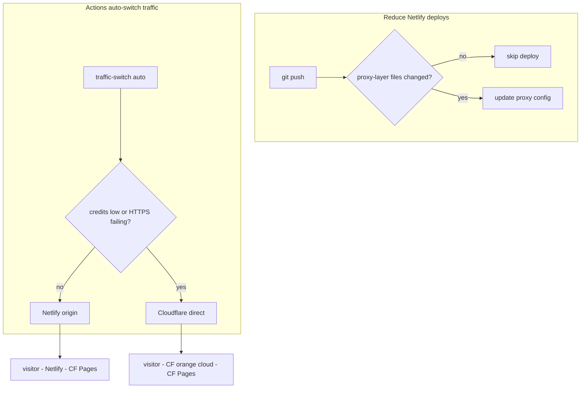

# Reworking the two-layer Cloudflare + Netlify deployment

This post records a recent rework of the site's **Cloudflare Pages + Netlify origin proxy** setup: keeping Netlify as an optional CDN entry point while sharply cutting pointless deploys, and **automatically switching back to Cloudflare directly via GitHub Actions** when credits run out or HTTPS is unavailable, with no manual DNS or Pages panel changes.

## Background: the original architecture

The site used a two-layer CDN:

```text
visitor → www.vedaru.cn (Netlify)
        → 200 origin proxy → vedarublog-github-io.pages.dev (Cloudflare Pages)
```

Netlify hosts almost no real content; it generates a single `_redirects` rule forwarding everything to Cloudflare Pages. The actual Astro build and static assets live on Cloudflare Pages.

The idea was to combine the strengths of both. After running for a while, a few problems surfaced.

## What went wrong

### 1. Netlify credits burned too fast

The Netlify free plan gives roughly 300 credits a month, and each production deploy costs about 15. Every push triggered a Netlify build even when the change had nothing to do with the proxy layer: 19 deploys gets you close to 285 credits.

### 2. HTTPS timeouts from mainland China

Netlify's edge (`75.2.60.5:443`) is frequently unreachable from mainland China, showing `ERR_TIMED_OUT`, while the Cloudflare Pages origin `*.pages.dev` works fine over HTTPS. The two-layer proxy was actually worse for availability.

### 3. The site went down when credits ran out

Once credits were exhausted Netlify paused the site, but DNS still pointed at Netlify, so visitors could not reach it. An **automatic fallback** was needed for when Netlify is unavailable.

## Overview of the rework

Two parallel tracks:

| Goal | Implementation |
|------|----------------|
| Fewer deploys | `netlify.toml` + `scripts/netlify-should-build.mjs` |
| Automatic traffic switching | `scripts/netlify-traffic-switch.mjs` + GitHub Actions |



## 1. Skipping pointless Netlify deploys

Configure an ignore hook in `netlify.toml`:

```toml
[build]
  ignore = "node ./scripts/netlify-should-build.mjs"
  command = "node ./scripts/netlify-proxy-build.js"
  publish = "dist"
```

The script is simple: `git diff` **only against the proxy-layer files**:

```text
netlify.toml
scripts/netlify-proxy-build.js
scripts/netlify-should-build.mjs
```

- No proxy-layer change → exit 0 → **skip deploy**
- Proxy-layer change → exit 1 → run the deploy

So editing posts, components, `astro.config`, CI workflows and so on **no longer triggers a Netlify build**. If credits are already exhausted you can also use Netlify UI → **Stop builds** to stop automatic builds entirely.

## 2. Automatic DNS switching with GitHub Actions

Workflow file: `.github/workflows/netlify-traffic.yml`

- **Scheduled**: a `cron` check every 2 hours (`mode=auto`, no manual action)
- **Manual**: Actions → Netlify Traffic Switch → optional `cloudflare` / `netlify` / `dry_run`

The core script `scripts/netlify-traffic-switch.mjs` in **auto mode** will:

1. Call the Netlify API to estimate remaining credits this month
2. Check whether the Netlify site is paused
3. Probe whether `https://www.vedaru.cn` serves HTTPS
4. If the switch conditions are met:
   - **Register** `www.vedaru.cn` (and the apex) via the Cloudflare Pages API
   - Change Cloudflare DNS: `www` CNAME → `vedarublog-github-io.pages.dev`, **forcing the orange cloud**
   - Sync the apex record
5. Write the state to `.github/netlify-traffic-state.json` and commit it

### Switch conditions

| Direction | Condition |
|-----------|-----------|
| Netlify → Cloudflare | credits remaining ≤ 45, or the site is unavailable, or the HTTPS probe fails |
| Cloudflare → Netlify | currently in CF mode and credits remaining > 105 |

### Required GitHub secrets

| Secret | Purpose |
|--------|---------|
| `CF_API_TOKEN` | Zone DNS Edit (vedaru.cn) |
| `CF_PAGES_API_TOKEN` | Optional; Account Cloudflare Pages Edit |
| `CF_ZONE_ID` | vedaru.cn Zone ID |
| `NETLIFY_AUTH_TOKEN` | Netlify Personal Access Token |
| `NETLIFY_SITE_ID` | Netlify Site ID |
| `NETLIFY_CNAME_TARGET` | e.g. `xxx.netlify.app` |

The Cloudflare API token needs two permission groups:

- **Zone → DNS → Edit** (change the CNAME, enable the orange cloud)
- **Account → Cloudflare Pages → Edit** (register the custom domain)

With DNS permission only, the script can still change DNS, but the Pages API will return `Authentication error` and the site may keep returning **522**, because the domain is not activated on the Pages project.

You can also fold the Pages permission into the same `CF_API_TOKEN`, or create a separate `CF_PAGES_API_TOKEN`.

### Local debugging

```bash
# Check only, do not modify DNS
DRY_RUN=1 node scripts/netlify-traffic-switch.mjs

# Run for real (requires environment variables)
pnpm netlify-traffic
```

## Pitfalls I hit

### dry_run accidentally enabled

A GitHub Actions boolean input can arrive in an expression as the string `"false"`, which is still truthy for `&&`. The workflow now compares explicitly:

```yaml
DRY_RUN: ${{ (github.event.inputs.dry_run == true || github.event.inputs.dry_run == 'true') && '1' || '' }}
```

Scheduled runs have no `inputs`, so `DRY_RUN` is empty, meaning it **will really change DNS**.

### www was an A record, not a CNAME

Early versions of the script only looked at CNAMEs, while `www.vedaru.cn` was actually an A record pointing at `75.2.60.5`. It now handles conversion between A / CNAME / AAAA.

### 522: DNS changed but Pages not activated

After switching to Cloudflare, if `www` is **grey cloud** (DNS only), or `www.vedaru.cn` was not added to the Pages project, you get a 522. The script now:

- registers the Pages custom domain
- forces `proxied: true` (orange cloud)
- changes DNS before registering Pages, so that if the Pages API fails the DNS is at least updated

### Bug in the Netlify ignore script

When `CACHED_COMMIT_REF` was missing and the return type was wrong, Node exited with code 1, which Netlify read as "build needed". It now defaults to **skip** when the ref is missing.

## Summary

| Before | After |
|--------|-------|
| Deploy on every push, credits drained fast | Deploy only on proxy-layer changes |
| Manual DNS edits when credits ran out or HTTPS broke | Actions switches automatically every 2h |
| 522 required manually enabling the orange cloud and binding the Pages domain | Done in one API call by the script |

Total cost is still **$0**: GitHub Actions is free for public repos, Cloudflare Pages is free, and Netlify's free allowance is enough to keep proxy-layer updates flowing once pointless deploys are skipped.

If you run a similar "Netlify proxy + CF origin" setup, you can reuse this repository's `netlify.toml`, `.github/workflows/netlify-traffic.yml` and the two scripts under `scripts/` directly.

