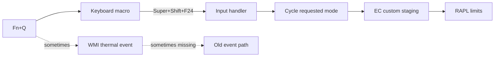

# Fn+Q was never a WMI event

The first Fn+Q press after boot changed the keyboard light and the fan noise. The CPU power limits stayed where they were. Press it again and everything worked. The first press was just gone.

I spent a stupid amount of time looking for that missing event in ACPI. It was not there.

## The laptop

It is a Legion Y9000P IAX10, model `83F4`, with a Core Ultra 9 275HX and an RTX 5060. Under Linux the CPU liked to sit at about 30 W, no matter what the firmware said about the current thermal mode.

The EC has three useful modes:

| Mode | CPU PL1 | CPU PL2 | GPU TGP |
| --- | ---: | ---: | ---: |
| Quiet | 55 W | 65 W | 50 W |
| Balanced | 90 W | 125 W | 80 W |
| Performance | 145 W | 190 W | 100 W |

The GPU figures are base TGP. Dynamic Boost can add up to 15 W.

The annoying part is that the EC only accepts CPU power-limit writes in `custom`. A normal mode change is a short sequence: switch to `custom`, write PL1 and PL2, switch back, read the mode back, and let the firmware publish the values to RAPL. On battery I clamp every mode to 55/65 W. On AC each mode gets its full numbers.

That sequence lives in [`legion-own`](https://git.vedaru.cn/Vedaru/legion-own). It also does platform profiles, fan curves, battery conservation and rapid charge, but none of that matters here.

::forgejo{repo="Vedaru/legion-own"}

## Someone else already mapped the firmware

I did not figure out the EC side from scratch. Pengbo wrote [Lenovo Legion Y9000P 在 Linux 下只有 30W：从现象、WMI 到驱动补丁](https://pengs.top/Y9000P-fix/) in April 2026, and it is still the clearest description I have found of what this machine's firmware is doing.

That post established the parts I would otherwise have spent another week guessing: `custom` is firmware thermal mode `0xff`, `max-power` is `0xe0`, PPT writes are rejected outside `custom`, and the in-tree `lenovo-wmi-other` driver was building the wrong attribute ID for `current_value` reads and writes. It also has the WMI probes and the stress-test numbers to back all of it up.

I used that as my map for the EC. This post is about the part that came after: even with the EC side correct, Fn+Q could still fail to tell Linux that the mode had changed. Thanks to Pengbo for writing the original investigation down.

## The event that sometimes was not there

Fn+Q is supposed to cycle quiet, balanced and performance. The LED changes immediately. The driver is supposed to notice and apply the matching limits.

Sometimes it did. The first press after boot was the usual failure. The LED moved, the fans changed, the mode selector stayed on the old value, and RAPL did not move.

I did not want a daemon for this. There is no systemd unit, no udev rule, no polling loop, no EFI variable. The driver is a kernel module. It reacts to events. If the event does not arrive, nothing happens.

The obvious place to look was the Lenovo WMI event interface. I built a throwaway logger that printed every WMI GUID the machine exposes, then hit Fn+Q until I could see a pattern.

The relevant one was:

```text
D320289E-8FEA-41E0-86F9-611D83151B5F
```

It carries an 8-byte buffer with the mode and a firmware version. `911D` carries an integer duplicate. `711D`, `811D` and `CE6C` did nothing when I pressed the key.

When an event arrived, the payload and the EC readback agreed, and the driver did the right thing. The failure was not a bad value. It was silence. The EC had changed state and Linux had not been told.

This is not something I got wrong in my parser. The official `lenovo-wmi-events` driver misses it too. There is an upstream report, kernel Bugzilla `221908`, open since August 2026. The short version is that `SMARTFAN_GET` reports the logical selected mode, while the EC's effective state may already be somewhere else, so the driver can fail to emit `LWMI_EVENT_THERMAL_MODE`.

I tried the official notifier for a while. It behaved exactly the same way. When the event existed it was fine. When the first press produced nothing, there was nothing to consume.

I could have added a poll. Or a fixed delay. Or an echo-suppression window. All of those make an unreliable event look reliable for a while, and then the driver disagrees with the hardware again, usually at a worse moment. I did not want to build that.

So I gave up on Fn+Q. I would pick another key and handle it in the kernel. No WMI event, no firmware notification, no guessing.

I picked a key and started capturing input events.

## "No, that is Fn+Q"

The capture looked like this:

```text
keycode=125   # KEY_LEFTMETA
keycode=42    # KEY_LEFTSHIFT
keycode=193   # KEY_F24
```

I thought I was looking at a macro key. Three modifiers and an F24 at the end. I bound `KEY_F24` and it worked every time.

Then it clicked. The key I had just pressed was Fn+Q. The one I had spent days trying to fix.

So Fn+Q on this machine is not an ACPI event at all. It is a keyboard macro that emits `Super+Shift+F24`. The EC may still react to it inside the firmware, but the key reaches Linux as a normal input event on every press. The WMI notification was a second, optional, unreliable copy of the same information.

I had spent days trying to fix the firmware notification when the reliable signal was a keycode.



## Listening for F24

The handler is small. It only cares about F24, and only about the initial press. Key repeat is ignored.

```c
static void fnq_event(struct input_handle *handle, unsigned int type,
		      unsigned int code, int value)
{
	if (type == EV_KEY && code == KEY_F24 && value == 1)
		schedule_work(&fnq_work);
}
```

The work item advances the requested mode, not the last applied one:

```c
static void fnq_workfn(struct work_struct *work)
{
	u32 mode = READ_ONCE(requested_mode);

	switch (mode) {
	case MODE_QUIET:
		mode = MODE_BALANCED;
		break;
	case MODE_BALANCED:
		mode = MODE_PERFORMANCE;
		break;
	default:
		mode = MODE_QUIET;
		break;
	}
	request_mode(mode);
}
```

This matters when I hit the key twice quickly. The EC may still be applying the first mode. If the handler reads `actual_mode`, it can advance from a value that is already one step behind. `requested_mode` is the thing I just changed, so that is what the next press should advance.

The input handler needs a device ID table. It does not need to match a specific keyboard; every input device with `EV_KEY` is a candidate, and the event callback filters for F24.

```c
static const struct input_device_id fnq_ids[] = {
	{
		.flags = INPUT_DEVICE_ID_MATCH_EVBIT,
		.evbit = { BIT_MASK(EV_KEY) },
	},
	{ }
};

static struct input_handler fnq_handler = {
	.event = fnq_event,
	.match = fnq_match,
	.connect = fnq_connect,
	.disconnect = fnq_disconnect,
	.name = "legion-own-fnq",
	.id_table = fnq_ids,
};
```

## The oops I earned

My first version left `.id_table` out.

`modprobe` returned 139. The kernel log showed a general protection fault in `input_attach_handler`:

```text
RIP: input_attach_handler.isra.0+0x12/0xa0
kernel NULL pointer dereference at 0x0
```

I had assumed a NULL `id_table` meant "match every input device". It does not. The input core expects a real, NULL-terminated table, and my handler was handing it a null pointer. The crash was boring and entirely my fault. The fix was the table above.

I also had to open each accepted device in `connect` and close it in `disconnect`. Without that, the handle does not receive the event stream. The final handler has no userspace process, no polling and no timer. It is just another consumer of the keyboard events that were already there.

## Deleting the old path

Once Fn+Q worked through input, all the WMI event code became dead weight. I removed:

- `event_work` and `wmi_notify`
- the `applying` atomic and the duplicate-event suppression cache
- the `last_valid`, `last_mode`, `last_pl1` and `last_pl2` state
- the `issue_mode` wrapper
- `.min_event_size` from the WMI driver

What is left is one WMI device for the EC methods, one delayed work item for mode changes, and one input handler for Fn+Q. No polling, no timer, no daemon.

I also deleted the official Lenovo WMI modules. The `lenovo-wmi-*.ko` files are gone from `/lib/modules/7.3.2-vedaru`, gone from the initramfs, and all of the modules are blacklisted:

```text
blacklist lenovo_wmi_gamezone
blacklist lenovo_wmi_other
blacklist lenovo_wmi_capdata
blacklist lenovo_wmi_events
blacklist lenovo_wmi_camera
blacklist lenovo_wmi_hotkey_utilities
blacklist lenovo_wmi_helpers
```

The files can come back with a kernel update. The blacklist is the part that lasts. The driver does not need any of them.

## Does it actually work?

After a reboot:

- `legion_own` reports `9671da2`, refcount `0`.
- No `lenovo_wmi_*` modules are loaded.
- Fn+Q does not depend on a WMI event.
- The LED, the selector and the RAPL limits agree.
- The smoke test passes `32/32`, including PL1/PL2 and the GPU TGP ordering.

Fn+Q now behaves like a key. Press it, the mode advances, the EC is staged through `custom`, the limits are written, and the mode is read back. The first press after boot behaves like the tenth.

## Things that are still rough

This is still a driver for one machine. It refuses to load unless DMI says `LENOVO` and product `83F4`, because the WMI interface is specific to this model.

Under a heavy game load, the firmware or DPTF can still pull RAPL PL1 down to around 55 W. That is a thermal decision, not a mode-sync failure. The stress test can fail in that state even when Fn+Q did exactly what it was supposed to do.

`custom` is still an internal staging mode. It is not exposed as a user profile. The public modes remain quiet, balanced and performance.

The official drivers are gone from this kernel, not from the upstream source. A future kernel package can put the files back. The blacklist keeps them from loading, but a truly clean tree needs them deleted again.

Keyboard lighting is still not exposed. The RGB keyboard on this model is a separate USB-HID device, not part of the EC power path. That is a different project.

## What I keep thinking about

I was not wrong about the WMI event. It exists. It carries real data. The official driver has a real bug. But it was never the interface I needed.

The key was the interface. It was there the whole time, in the input layer, with a silly `Super+Shift+F24` macro attached to it.

The useful question was not "why is this event missing?" It was "why did the hardware state change while the event stream stayed quiet, and who else saw that change?" Once I asked that, the answer was a few lines of input code.

The final driver is smaller than the version with the event workaround. That is usually a good sign. I deleted the cache, the suppression state and the official notifier, and the thing became easier to reason about, not harder.

Fn+Q was a key. I should have treated it as one much earlier.

Thanks again to Pengbo for the original Y9000P firmware write-up. It saved me from re-deriving the EC side while I was busy looking in the wrong layer.
