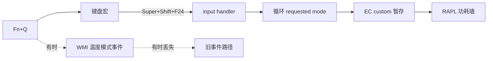

# Fn+Q 从来不是 WMI 事件

开机后第一次按 Fn+Q，键盘背光变了，风扇也变了，CPU 功耗墙没动。再按一次，一切正常。第一次就像没发生过。

我在 ACPI 里找了很久那条根本不存在的通知。

## 机器

Legion Y9000P IAX10，型号 `83F4`，Core Ultra 9 275HX，RTX 5060。Linux 下 CPU 经常稳稳停在 30 W 左右，不管固件说自己在哪个模式。

EC 有三个能用的模式：

| 模式 | CPU PL1 | CPU PL2 | GPU TGP |
| --- | ---: | ---: | ---: |
| 安静 | 55 W | 65 W | 50 W |
| 均衡 | 90 W | 125 W | 80 W |
| 性能 | 145 W | 190 W | 100 W |

GPU 这里是基础 TGP，Dynamic Boost 还能再加最多 15 W。

麻烦的地方在于，EC 只在 `custom` 模式下接受 CPU 功耗墙写入。所以一次模式切换要绕一圈：先进 `custom`，写 PL1/PL2，切回目标模式，读回确认，然后等固件把值发布到 RAPL。接电池时我把所有模式压到 55/65 W，接电源时才放开。

这套流程在 [`legion-own`](https://git.vedaru.cn/Vedaru/legion-own) 里。驱动还管 platform profile、风扇曲线、电池养护和快充，但这些和本文关系不大。

::forgejo{repo="Vedaru/legion-own"}

## EC 这一侧，Pengbo 已经写过了

EC 这部分不是我一个人从零摸出来的。Pengbo 在 2026 年 4 月写过 [Lenovo Legion Y9000P 在 Linux 下只有 30W：从现象、WMI 到驱动补丁](https://pengs.top/Y9000P-fix/)，把 30 W 的来龙去脉讲得很清楚。

那篇文章确认了 `custom` 对应固件 thermal mode `0xff`，`max-power` 对应 `0xe0`，CPU PPT 只能在 `custom` 下写，以及内核自带的 `lenovo-wmi-other` 在 `current_value` 读写时拼错了 attribute ID。里面还有 WMI probe 和 stress-ng 的数据，不是只靠猜。

我拿它当 EC 侧的地图。这篇文章讲的是后面一半：就算 EC 侧都对了，Fn+Q 还是可能不告诉 Linux 模式已经变了。谢谢 Pengbo 把这些写下来。

## 有时候有事件，有时候没有

Fn+Q 应该在安静、均衡、性能之间循环。按下后 LED 立刻变。驱动应该收到通知，然后应用对应的功耗墙。

有时候确实会。开机后的第一次最容易失败：灯动了，风扇变了，模式选择器还停在旧值，RAPL 没动。

我不想为这个写守护进程。没有 systemd 服务，没有 udev 规则，没有轮询，没有 EFI 变量。驱动是内核模块，本来就该靠事件活着。事件不来，它就什么都不知道。

最该查的是 Lenovo 的 WMI 事件接口。我写了个临时 logger，把机器上所有 WMI GUID 都打出来，然后反复按 Fn+Q。

相关的是这个：

```text
D320289E-8FEA-41E0-86F9-611D83151B5F
```

它带一个 8 字节 buffer，里面是模式和一个固件版本号。`911D` 是整数形式的副本。`711D`、`811D`、`CE6C` 按 Fn+Q 时都没有反应。

事件来的时候，payload 和 EC 读回的值对得上，驱动也能正确应用。问题不是值错了，是根本没事件。EC 自己变了，Linux 不知道。

这不是我解析错了。官方的 `lenovo-wmi-events` 驱动也漏。内核 Bugzilla 有个报告，编号 `221908`，从 2026 年 8 月开到现在。大意是 `SMARTFAN_GET` 报的是逻辑上选中的模式，而 EC 的实际状态可能已经变了，于是驱动可能不生成 `LWMI_EVENT_THERMAL_MODE`。

我也试过官方 notifier。结果一样。事件存在时它很好用，事件不来时它也没东西可消费。

我可以加轮询，或者固定延迟，或者回声抑制窗口。这些东西都能让不可靠的事件看起来可靠一阵，然后驱动又和硬件不一致，通常还在更糟的时候。我不想搭这种结构。

所以我放弃 Fn+Q，打算自己选个键，用内核 input handler 来循环模式。没有 WMI 事件，没有固件通知，也不用猜。

我自己按了一个键，开始抓输入。

## “不对，那就是 Fn+Q”

抓到的数据长这样：

```text
keycode=125   # KEY_LEFTMETA
keycode=42    # KEY_LEFTSHIFT
keycode=193   # KEY_F24
```

我以为是某个宏键：三个修饰键，最后跟一个 F24。于是绑了 `KEY_F24`，结果每次都灵。

然后我才反应过来：我刚才按的就是 Fn+Q，就是我折腾了好几天的那个键。

这台机器上的 Fn+Q 根本不是 ACPI 事件。它是一个键盘宏，发出 `Super+Shift+F24`。EC 可能仍然会在固件里响应，但这个键每次都会以普通输入事件的形式到达 Linux。WMI 事件只是同一件事的第二份通知，而且不可靠。

我花了好几天修固件通知，真正稳定的信号是一个 keycode。



## 监听 F24

Handler 很小，只关心 F24，而且只关心第一次按下。长按的重复事件不管。

```c
static void fnq_event(struct input_handle *handle, unsigned int type,
		      unsigned int code, int value)
{
	if (type == EV_KEY && code == KEY_F24 && value == 1)
		schedule_work(&fnq_work);
}
```

工作项前进的是 `requested_mode`，不是已经应用的模式：

```c
static void fnq_workfn(struct work_struct *work)
{
	u32 mode = READ_ONCE(requested_mode);

	switch (mode) {
	case MODE_QUIET:
		mode = MODE_BALANCED;
		break;
	case MODE_BALANCED:
		mode = MODE_PERFORMANCE;
		break;
	default:
		mode = MODE_QUIET;
		break;
	}
	request_mode(mode);
}
```

我连按两次时，这一点很关键。EC 可能还在应用第一次的模式。如果 handler 读 `actual_mode`，它可能从一个已经落后一步的值继续走。`requested_mode` 是我刚刚改过的值，下一次按键应该从它往前走。

input handler 需要一个 device ID 表。它不用匹配某一块特定键盘：所有带 `EV_KEY` 的设备都是候选，具体按键由回调过滤。

```c
static const struct input_device_id fnq_ids[] = {
	{
		.flags = INPUT_DEVICE_ID_MATCH_EVBIT,
		.evbit = { BIT_MASK(EV_KEY) },
	},
	{ }
};

static struct input_handler fnq_handler = {
	.event = fnq_event,
	.match = fnq_match,
	.connect = fnq_connect,
	.disconnect = fnq_disconnect,
	.name = "legion-own-fnq",
	.id_table = fnq_ids,
};
```

## 自己写出来的 oops

第一个版本没写 `.id_table`。

`modprobe` 返回 139。内核日志里是 `input_attach_handler` 的 general protection fault：

```text
RIP: input_attach_handler.isra.0+0x12/0xa0
kernel NULL pointer dereference at 0x0
```

我以为 `id_table` 为 NULL 就是“匹配所有输入设备”。不是。input core 要一个真实的、以 NULL 结尾的表，我给了一个空指针。这个崩溃很无聊，完全是我的问题。补上表就好了。

另外，`connect` 里要打开被接受的设备，`disconnect` 里关掉，否则这条 handle 收不到事件流。最后的 handler 没有用户态进程，没有轮询，也没有定时器，只是键盘事件的一个额外消费者。

## 把旧路径删掉

Fn+Q 走通 input 之后，原来的 WMI 事件代码就没用了。我删了：

- `event_work` 和 `wmi_notify`
- `applying` 原子变量和重复事件抑制缓存
- `last_valid`、`last_mode`、`last_pl1`、`last_pl2`
- `issue_mode` 包装函数
- WMI driver 的 `.min_event_size`

剩下的是一个用于 EC 方法的 WMI 设备，一个负责应用模式的 delayed work，一个处理 Fn+Q 的 input handler。没有轮询，没有定时器，没有守护进程。

我还把官方 Lenovo WMI 模块删了。`lenovo-wmi-*.ko` 已经从 `/lib/modules/7.3.2-vedaru` 和 initramfs 里消失，并且全部拉黑：

```text
blacklist lenovo_wmi_gamezone
blacklist lenovo_wmi_other
blacklist lenovo_wmi_capdata
blacklist lenovo_wmi_events
blacklist lenovo_wmi_camera
blacklist lenovo_wmi_hotkey_utilities
blacklist lenovo_wmi_helpers
```

内核升级会把文件装回来，黑名单会阻止它们加载。驱动不需要它们。

## 到底有没有用

重启之后：

- `legion_own` 版本 `9671da2`，refcount `0`。
- 没有任何 `lenovo_wmi_*` 模块加载。
- Fn+Q 不依赖 WMI 事件。
- 灯、选择器、RAPL 功耗墙一致。
- smoke test `32/32` 通过，包括三个模式的 PL1/PL2 和 GPU TGP 排序。

现在 Fn+Q 就是一个普通按键。按下去，模式前进，EC 进 `custom` 暂存，写功耗墙，读回确认。开机后第一次和第十次没有区别。

## 还糙的地方

这仍然是一台机器的驱动。DMI 不是 `LENOVO` / `83F4` 就直接拒绝加载，因为 WMI 接口只适用于这个型号。

重度游戏负载下，固件或 DPTF 还是可能把 RAPL PL1 拉到 55 W 左右。那是热管理决策，不是模式同步失败。这时候 stress test 可能过不了，但 Fn+Q 本身没做错。

`custom` 仍然是内部暂存模式，不暴露给用户。公开模式还是安静、均衡、性能。

官方驱动是从当前内核删掉的，不是从上游源码删掉的。以后装新内核，文件可能又回来。黑名单能挡住加载，但想要一棵干净的树，还是得再删一次。

键盘灯效也没做。这台机器的 RGB 键盘是独立的 USB-HID 设备，不在 EC 功耗路径上。那是另一个项目。

## 我后来一直在想的事

WMI 事件不是假的。它确实存在，确实带数据，官方驱动也确实有 bug。但它从来不是我要的那个接口。

按键才是。它一直都在输入层，还带着一个看起来有点傻的 `Super+Shift+F24` 宏。

真正该问的不是“这个事件为什么丢了”，而是“硬件状态已经变了，事件流为什么安静，还有谁看到了这个变化”。问出这句话之后，答案就是几行 input 代码。

最后的驱动比带事件 workaround 的版本更小。删掉缓存、抑制状态和官方 notifier 之后，它没有更难懂，反而更容易解释。

Fn+Q 就是个键。我应该早点把它当键看。

再次谢谢 Pengbo 那篇 Y9000P 固件排查。我在错误的一层忙的时候，它帮我省掉了重新推导 EC 侧的功夫。
