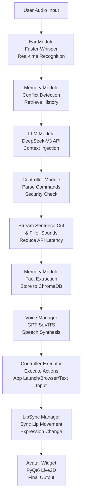
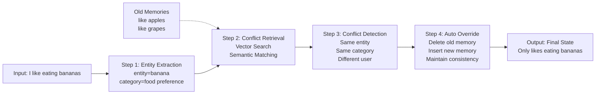

# Local: an AI virtual streamer and computer-control system built on DeepSeek and a hybrid architecture

::github{repo="Vedaru/Local-project"}

Local is an AI virtual streamer system combining speech recognition (ASR), a large language model (LLM), a long-term memory system (RAG), high-quality speech synthesis (TTS) and computer control. The goal is to build a digital life in the spirit of Neuro-sama: driven by a hybrid of local compute and cloud APIs, delivering highly intelligent interaction at low latency, with automated computer operation.

## 🚀 Technical stack

The project uses a "cloud brain + local senses + computer control" hybrid architecture, making full use of the RTX 5060's local inference power:

*   **Brain:** [DeepSeek-V3 (API)](https://www.deepseek.com/)
    *   Handles the core dialogue logic, persona performance and stream interaction.
*   **Ear:** [Faster-Whisper (local)](https://github.com/SYSTRAN/faster-whisper)
    *   Local GPU-accelerated speech-to-text, receiving voice commands in milliseconds.
*   **Voice:** [GPT-SoVITS (local)](https://github.com/RVC-Boss/GPT-SoVITS)
    *   Locally deployed high-quality emotional speech synthesis with zero-shot voice cloning.
*   **Analyst:** [Qwen-Turbo (API)](https://help.aliyun.com/zh/model-studio/)
    *   Distils key facts from the conversation stream, turning short-term memory into structured information.
*   **Memory:** [ChromaDB (local)](https://www.trychroma.com/)
    *   A local vector database storing vast quantities of historical conversational facts for an experience that "never forgets".
*   **Body:** [Live2DViewerEX](https://store.steampowered.com/app/616720/Live2DViewerEX/)
    *   A cross-platform avatar driver supporting desktop widget mode and API integration.
*   **Controller:** [PyAutoGUI + subprocess (local)](https://pyautogui.readthedocs.io/)
    *   Local computer automation: launching apps, opening pages, typing text, saving notes.

## 🛠️ Key mechanisms

### 1. Two-track memory pipeline
Memory is managed at two levels:
- **Short-term:** a context window of the last 15 turns.
- **Long-term:** when the window overflows, `Qwen-Turbo` distils facts and stores them in `ChromaDB`. Before answering, the system retrieves relevant facts and injects them into `DeepSeek-V3`'s prompt.

### 2. Low-latency response stream
To avoid dead air while the AI thinks, the project implements:
- **Streaming sentence splitting:** punctuation in DeepSeek's output is detected in real time, so it can "think while speaking".
- **Filler sounds:** during API requests, interjections such as "um..." or "let me think" are played at random.

### 3. Desktop integration
Using Live2DViewerEX's remote control, the AI switches expressions automatically from emotion tags (such as `[happy]`) and renders as an always-on-top transparent widget.

### 4. Computer control system
A modular control architecture for safe automation:
- **Safety guard:** a whitelist validates application paths to prevent malicious actions
- **Action executor:** supports app launching, page visits, text input and file operations
- **Intelligent parsing:** the LLM parses user instructions into concrete actions

## 💻 Requirements
GPU: NVIDIA GeForce RTX 5060 (laptop, 8 GB VRAM) or higher.
Environment: CUDA 12.1 + cuDNN 8.9.x.
OS: Windows 10/11.
Python: 3.8+

---

## 📦 Full project structure

```
Local-project/
├── .env                        # Environment variables (API keys etc.)
├── .gitattributes             # Git config
├── .gitignore                 # Git ignore rules
├── config.yaml                # Main configuration file
├── main.py                    # Main entry point (text mode)
├── main copy.py               # Copy of the entry point (with speech recognition)
├── README.md                  # Project documentation
├── requirements.txt           # Python dependencies
├── __pycache__/               # Python cache
├── assets/                    # Asset directory
│   ├── audio_ref/             # Reference audio files
│   │   ├── ref_text.txt       # Transcript of the reference audio
│   └── web/                   # Frontend assets
│       ├── viewer.html        # Avatar viewer page
│       ├── js/                # JavaScript files
│       └── models/            # 3D model files
├── data/                      # Data storage
│   ├── chroma_db/             # Vector database
│   │   ├── chroma.sqlite3     # ChromaDB database file
│   │   └── [collection_dirs]/ # Collection data directories
│   ├── logs/                  # Log files
│   └── temp/                  # Runtime temporary files
├── GPT-SoVITS-v2pro-20250604-nvidia50/ # GPT-SoVITS speech engine
│   ├── api_v2.py              # API endpoint v2
│   ├── api.py                 # API endpoint
│   ├── batch_inference.py     # Batch inference
│   ├── config.py              # Configuration
│   ├── extra-req.txt          # Extra dependencies
│   ├── go-webui.bat           # Windows launch script
│   ├── go-webui.ps1           # PowerShell launch script
│   ├── install.ps1            # PowerShell install script
│   ├── install.sh             # Linux install script
│   ├── LICENSE                # License
│   ├── README.md              # GPT-SoVITS documentation
│   ├── requirements.txt       # Dependency list
│   ├── webui.py               # Web interface
│   ├── __pycache__/           # Python cache
│   ├── GPT_SoVITS/            # Core modules
│   │   ├── download.py        # Download utility
│   │   ├── export_torch_script_v3.py # TorchScript export
│   │   ├── inference_cli.py   # CLI inference
│   │   ├── inference_gui.py   # GUI inference
│   │   ├── inference_webui_fast.py # Fast web inference
│   │   ├── inference_webui.py # Web inference
│   │   ├── onnx_export.py     # ONNX export
│   │   ├── process_ckpt.py    # Checkpoint handling
│   │   ├── s1_train.py        # Stage 1 training
│   │   ├── s2_train_v3_lora.py # Stage 2 LoRA training
│   │   ├── s2_train_v3.py     # Stage 2 training v3
│   │   ├── s2_train.py        # Stage 2 training
│   │   ├── stream_v2pro.py    # Streaming inference v2pro
│   │   ├── sv.py              # Voice conversion
│   │   ├── utils.py           # Utility functions
│   │   ├── __pycache__/       # Cache
│   │   ├── AR/                # Acoustic model
│   │   ├── BigVGAN/           # Vocoder
│   │   ├── configs/           # Config files
│   │   ├── eres2net/          # Encoder
│   │   ├── f5_tts/            # TTS model
│   │   ├── feature_extractor/ # Feature extractor
│   │   ├── module/            # Core modules
│   │   ├── prepare_datasets/  # Dataset preparation
│   │   ├── pretrained_models/ # Pretrained models
│   │   ├── text/              # Text processing
│   │   └── TTS_infer_pack/    # TTS inference package
│   ├── GPT_weights/           # GPT model weights
│   │   ├── GPT_weights_v2/    # v2 weights
│   │   │   └── luotianyi-e50.ckpt
│   │   ├── GPT_weights_v2Pro/ # v2Pro weights
│   │   ├── GPT_weights_v2ProPlus/ # v2ProPlus weights
│   │   ├── GPT_weights_v3/    # v3 weights
│   │   └── GPT_weights_v4/    # v4 weights
│   ├── logs/                  # GPT-SoVITS logs
│   ├── output/                # Output directory
│   │   ├── asr_opt/           # ASR optimisation output
│   │   ├── slicer_opt/        # Audio slicing optimisation
│   │   └── uvr5_opt/          # UVR5 optimisation
│   ├── runtime/               # Bundled Python runtime
│   │   ├── 2.0/               # Python 2.0 compatibility
│   │   ├── Lib/               # Standard library
│   │   ├── Scripts/           # Scripts
│   │   └── ...                # Other runtime files
│   ├── SoVITS_weights/        # SoVITS model weights
│   │   ├── SoVITS_weights_v2/ # v2 weights
│   │   │   └── luotianyi_e16_s432.pth
│   │   ├── SoVITS_weights_v2Pro/ # v2Pro weights
│   │   ├── SoVITS_weights_v2ProPlus/ # v2ProPlus weights
│   │   ├── SoVITS_weights_v3/ # v3 weights
│   │   └── SoVITS_weights_v4/ # v4 weights
│   ├── TEMP/                  # Temporary files
│   └── tools/                 # Utility scripts
│       ├── __init__.py
│       ├── assets.py          # Asset management
│       ├── audio_sr.py        # Audio super-resolution
│       ├── cmd-denoise.py     # CLI denoising
│       ├── my_utils.py        # Custom utilities
│       ├── slice_audio.py     # Audio slicing
│       ├── slicer2.py         # Audio slicer 2
│       ├── subfix_webui.py    # WebUI fixups
│       ├── __pycache__/       # Cache
│       ├── AP_BWE_main/       # Audio processing
│       ├── asr/               # Automatic speech recognition
│       ├── denoise-model/     # Denoising model
│       ├── i18n/              # Internationalisation
│       └── uvr5/              # UVR5 source separation
├── modules/                   # Core module directory
│   ├── __init__.py            # Module initialisation
│   ├── _patch_ctranslate2.py  # CTranslate2 patch
│   ├── agent/                 # Agent submodule (ReAct agent + tools)
│   │   ├── __init__.py
│   │   ├── browser.py         # Browser / web retrieval tools
│   │   ├── core.py            # Agent core logic (ReAct loop)
│   │   └── tools.py           # Tool wrappers available to the agent
│   ├── config.py              # Configuration loading
│   ├── ear.py                 # Speech recognition module
│   ├── llm.py                 # LLM interface module
│   ├── logging_config.py      # Logging configuration
│   ├── utils.py               # Utility functions
│   ├── voice.py               # Speech synthesis module
│   ├── __pycache__/           # Python cache
│   ├── avatar/                # Avatar submodule
│   │   ├── __init__.py
│   │   ├── click_through.py   # Click-through
│   │   ├── expression.py      # Expression management
│   │   ├── js_communication.py # JS communication
│   │   ├── lip_sync.py        # Lip sync
│   │   ├── logger.py          # Logging
│   │   ├── manager.py         # Avatar manager
│   │   ├── resize.py          # Window resizing
│   │   ├── tray.py            # System tray
│   │   ├── webengine.py       # WebEngine integration
│   │   └── widget.py          # Main window widget
│   ├── controller/            # Computer control module
│   │   ├── __init__.py
│   │   ├── core.py            # Control core
│   │   └── safety.py          # Safety guard
│   └── memory/                # Memory management submodule
│       ├── __init__.py        # Memory module initialisation
│       ├── analyzers.py       # Text analysers
│       ├── config.py          # Memory configuration
│       ├── conflict/          # Conflict detection and override
│       │   ├── __init__.py
│       │   ├── constants.py
│       │   ├── detector.py
│       │   ├── locator.py
│       │   ├── models.py
│       │   ├── resolver.py
│       │   └── utils.py
│       ├── core.py            # Core memory management classes
│       ├── logger.py          # Logging configuration
│       ├── retrieval.py       # Memory retrieval and deduplication
│       └── storage.py         # Storage layer
└── temp/                      # Temporary file directory
```

## 📦 Module reference

### Core modules (modules/)

#### 1️⃣ **ear.py — the hearing module**
```
Purpose: real-time speech recognition (ASR)
Implementation:
  - Voice input via PyAudio + Faster-Whisper
  - CUDA acceleration (float16 precision)
  - Integrated RMS silence detection (VAD)
  - In-memory processing or temporary file storage
Characteristics:
  - Millisecond-latency live transcription
  - Automatic noise filtering
  - Multi-language recognition
```

#### 2️⃣ **llm.py — the brain module**
```
Purpose: dialogue generation and memory context injection
Implementation:
  - Calls the DeepSeek-V3 API (OpenAI-compatible format)
  - Up to two retries
  - Automatic text normalisation
  - Injects short-term / long-term / emotional memory into the system prompt
Characteristics:
  - Low-latency API response handling
  - Automatic retry on error
  - Memory-aware replies
```

#### 3️⃣ **voice.py — the speech synthesis module**
```
Purpose: text-to-speech (TTS) and audio playback
Implementation:
  - Integrates the local GPT-SoVITS model
  - Zero-shot voice cloning
  - Multi-threaded TTS queue plus audio playback
  - Low-latency configuration (256-sample buffer)
Characteristics:
  - Dual queue design: text queue -> audio queue -> playback
  - Warm-up to reduce first-sentence latency
  - PyAudio streaming output (32 kHz)
  - Emotional intonation
```

#### 4️⃣ **memory/ — human-like long-term memory**
```
Structure:
  ├── core.py (HumanLikeMemory & MemoryManager)
  ├── conflict.py (conflict detection and automatic override)
  ├── storage.py (ChromaDB vector store interaction)
  ├── retrieval.py (semantic retrieval and deduplication)
  ├── analyzers.py (entity extraction, sentiment analysis)
  └── config.py (memory configuration)

Core features:
  - Four-layer memory architecture:
    1. Short-term memory: context of the last 15 turns
    2. Working memory: the core facts of the current session
    3. Long-term memory: stored in the ChromaDB vector database
    4. Emotional memory: user preferences and emotion tags

  - Intelligent conflict detection (four steps):
    1. Entity location: extract keywords from the dialogue (e.g. "food", "film")
    2. Conflict retrieval: vector similarity plus semantic matching
    3. Judgement: apply rules to decide whether a conflict exists
    4. Automatic override: physically delete the old memory, insert the new record

  - Automatic override for same-category preferences:
    - "I like bananas now" automatically deletes "likes apples"
    - Deduplication based on the entity category
    - Keeps the user's most recent preference

  - Parallel retrieval and deduplication:
    - Multi-threaded retrieval of historical memories
    - Automatic removal of duplicate or similar fragments
```

#### 5️⃣ **avatar/ — virtual avatar driving**
```
Structure:
  ├── widget.py (PyQt6 WebEngine render window)
  ├── manager.py (thread-safe avatar controller)
  ├── lip_sync.py (lip sync)
  ├── expression.py (expression switching: Emotion enum)
  ├── js_communication.py (JS-Python two-way communication)
  ├── click_through.py (click-through)
  ├── tray.py (system tray integration)
  └── resize.py (window auto-sizing)

Features:
  - Live2D model rendering via WebEngine
  - Expression system: happy, angry, shy, neutral and more
  - Real-time lip sync from the audio waveform
  - Desktop widget mode: always-on-top transparent window
  - System tray control: minimise / show / quit
  - Click-through: interact with applications behind it
```

#### 6️⃣ **controller/ — computer control module**
```
Structure:
  ├── __init__.py
  ├── core.py (control core logic)
  ├── executor.py (action executor)
  └── safety.py (safety guard system)

Features:
  - App launching: safely start whitelisted applications
  - Page visits: open the browser at a given URL
  - Text input: simulate typing Chinese and English text
  - Note saving: automatically save conversation content to a file
  - Safety checks: whitelist validation to prevent malicious actions

Safety features:
  - Path validation: the app path must exist and be whitelisted
  - Command filtering: prevents dangerous system commands
  - Audit logging: every computer-control action is recorded
```

#### 7️⃣ **config.py & logging_config.py — configuration and logging**
```
Configuration keys:
  - ARK_API_KEY: DeepSeek or another LLM API key
  - SOVITS_URL: GPT-SoVITS service address (default http://127.0.0.1:9880)
  - REF_AUDIO: reference audio path (for voice cloning)
  - PROMPT_TEXT: the transcript of the reference audio
  - MODEL_NAME: LLM model name (e.g. deepseek-chat)
  - SYSTEM_PROMPT: system prompt (defines the AI persona)
  - GPT_SOVITS_PATH: local GPT-SoVITS path

Logging:
  - Categorised by module (ProjectLocal.Ear, ProjectLocal.LLM, etc.)
  - Output to data/logs/
  - Configurable debug level
```

### Entry point (main.py)

```python
Core classes:
  - AIWorkerSignals: Qt signals between the AI worker threads and the GUI
  - EarWorker: microphone listener thread, recognising speech in real time
  - AIWorker: the main AI thread (dialogue / memory / speech synthesis)

Workflow:
  1. EarWorker listens to the microphone -> text output
  2. AIWorker receives the text -> retrieves memory -> calls the LLM
  3. Controller parses commands -> safety check -> executes computer actions
  4. LLM returns a response -> distils memory facts -> stores them in ChromaDB
  5. VoiceManager synthesises speech -> plays the audio
  6. AvatarManager syncs expression and lip movement -> complete interaction
```

### Dependencies (requirements.txt)

Core dependencies:
- **openai**: LLM API calls (DeepSeek compatible)
- **chromadb**: vector database storage and retrieval
- **faster-whisper**: GPU-accelerated speech recognition
- **pyaudio**: audio input and output
- **PyQt6**: desktop GUI framework
- **PyQt6-WebEngine**: Live2D model rendering
- **pyautogui**: computer automation
- **jieba**: Chinese word segmentation (used by memory distillation)
- **pyyaml**: configuration parsing
- **python-dotenv**: environment variable management

---

## 🔄 Workflow in detail

### Complete interaction flow



### The four-step conflict detection in the memory system



---

## 🚀 Quick start

### 1. Environment setup

```bash
# Clone the project
git clone <repo-url>
cd Local-project

# Create a virtual environment (optional)
python -m venv venv
# Windows: venv\Scripts\activate
# Linux/Mac: source venv/bin/activate

# Install dependencies
pip install -r requirements.txt
```

### 2. API key configuration

Create a `.env` file:
```
ARK_API_KEY=your_deepseek_api_key
SYSTEM_PROMPT=You are an AI virtual streamer named Local, cheerful and outgoing.
MODEL_NAME=deepseek-chat
GPT_SOVITS_PATH=./GPT-SoVITS-v2pro-20250604-nvidia50
```

### 3. Start the GPT-SoVITS service

```bash
cd GPT-SoVITS-v2pro-20250604-nvidia50
python api.py  # serves TTS at http://127.0.0.1:9880
```

### 4. Run the main program

```bash
python main.py
```

Input modes:
- **Plain input**: type text to start a conversation
- **Computer control**:
  - "open QQ" - launch the QQ application
  - "open Baidu" - open the browser at Baidu
  - "save note: content" - save a note to a file
  - "type text: content" - type text into the current window
- **exit/quit**: quit the program
- **status**: show memory system status

---

## 🎯 Advanced features

### Low-latency design
- **Streaming sentence splitting**: punctuation detected in real time, generating and playing as it goes
- **Filler sounds**: interjections ("um...", "let me think...") during API responses
- **Warm-up**: the TTS model warms up at start-up to reduce first-sentence latency
- **Small buffer**: a 256-sample buffer (32 kHz) for the lowest possible latency

### Human-like memory
- **Forgetting curve**: historical memories decay over time, mimicking real forgetting
- **Emotional weighting**: emotionally charged conversations are kept preferentially
- **Deduplication**: detects and removes duplicate or similar memory fragments
- **Conflict override**: resolves contradictory memories automatically to stay consistent

### Avatar interaction
- **Expressions**: happy 😊 / angry 😠 / shy 😳 / neutral 😐 and more
- **Lip sync**: precise mouth shapes from the audio waveform
- **Desktop widget**: always-on-top transparent window with click-through
- **System tray**: minimise / show / quick quit

### Computer control
- **Intelligent command parsing**: the LLM understands instructions and turns them into concrete actions
- **Safe execution**: a whitelist prevents malicious actions, with path validation
- **Multiple operations**: app launching, web browsing, text input, note saving
- **Cross-platform paths**: handles Windows path and command formats
- **Action logging**: every computer-control action is recorded for debugging

---

## 📊 Key configuration (config.yaml)

```yaml
# API configuration
api:
  ark_api_key: ""  # read from .env
  sovits_url: "http://127.0.0.1:9880"

# Audio configuration
audio:
  ref_audio_path: "assets/audio_ref/ref_audio.wav"
  prompt_text: "Hello everyone, I am the virtual singer Luo Tianyi..."
  sample_rate: 32000

# Memory configuration
memory:
  data_dir: "data/chroma_db"
  collection_name: "seeka_memory"

# Computer control configuration
controller:
  whitelist:  # applications allowed to be launched
    - "C:\\Program Files\\Tencent\\QQ\\Bin\\QQ.exe"
    - "C:\\Program Files\\Google\\Chrome\\Application\\chrome.exe"
  browser_path: "C:\\Program Files\\Google\\Chrome\\Application\\chrome.exe"
  notes_path: "data/notes"
  safety_enabled: true

# Logging configuration
logging:
  log_dir: "data/logs"
```

---

## 💡 Highlights

1. **Optimised hybrid architecture**: full use of the local GPU, calling cloud APIs only where it matters
2. **Modular design**: each feature implemented independently, easy to extend and maintain
3. **Real-time performance**: millisecond speech recognition, second-scale dialogue response
4. **Human-friendly interaction**: streaming dialogue, emotional expression, long-term memory
5. **Computer control integration**: safe automated operation with intelligent command parsing
6. **Fully local where it counts**: no reliance on commercial cloud services, so data privacy is protected
