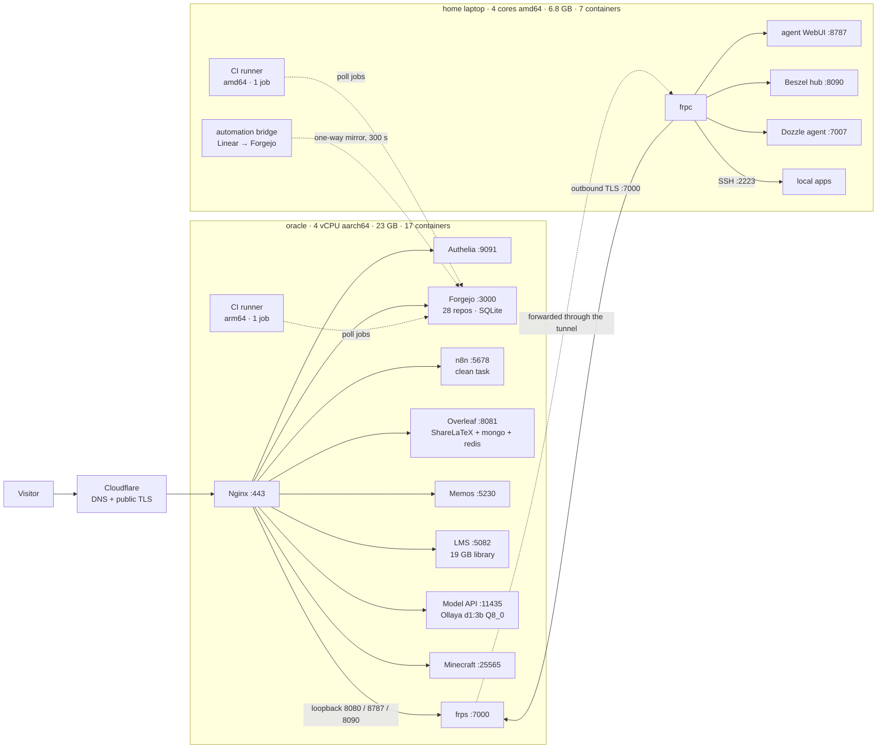

# Two boxes, 24 containers, no SaaS

This is the whole of my cloud: one 4-core ARM VPS and one laptop at home. Between them they run 24 containers, serve 13 hostnames, host my git forge, my CI, my automation, my notes, my LaTeX, my music library, a Minecraft world and a language model. Nothing in the critical path is a subscription.

## The two machines

| | oracle | laptop |
| --- | --- | --- |
| **Role** | edge, forge, CI, model, most services | home node: automation bridge, second CI arch, local apps |
| **CPU** | 4 vCPU aarch64 | 4 cores amd64 |
| **RAM** | 23 GB | 6.8 GB |
| **Disk** | 193 GB SSD (74 GB used) | 233 GB NVMe (89 GB used) |
| **OS** | Ubuntu 26.04 LTS, kernel 7.0.0-1009-oracle | Ubuntu, 17 days uptime |
| **Containers** | 17 | 7 |
| **Exposure** | public via Cloudflare | none, only through an FRP tunnel |

## One edge, one login

nginx is the only thing listening on 443, and it fronts every service on both machines. Cloudflare terminates public TLS. Authelia sits in front of the panels via `auth_request`, so there is exactly one login for everything that isn't meant to be public.

| Hostname | Upstream | What it is |
| --- | --- | --- |
| `git.vedaru.cn` | `:3000` (+ `:8787`) | Forgejo |
| `n8n.vedaru.cn` | `:5678` | n8n, behind Authelia |
| `jev.vedaru.cn` | `:11435` | model API |
| `overleaf.vedaru.cn` | `:8081` | ShareLaTeX 6.3.1 (arm64) + mongo 8.2 + redis 7.4 |
| `memos.vedaru.cn` | `:5230` | notes (own fork, TOTP) |
| `music.vedaru.cn` | `:5082` | LMS server, 19 GB library |
| `monitor.vedaru.cn` | `:8090` → tunnel | Beszel |
| `dozzle.vedaru.cn` / `portainer` | `:8080` | Dozzle, behind Authelia |
| `hermes.vedaru.cn` | `:8787` → tunnel | agent WebUI, behind Authelia |
| `auth.vedaru.cn` | `:9091` | Authelia |
| `paperclip`, `plan` | own apps | |

Per-site limits are tuned rather than global: git accepts 512 MB pushes, the panels 100 MB, the model API 16 MB. Certificates renew on a `certbot.timer`.

## The forge is the centre of gravity

Forgejo 20261017.1, built with Go 1.25, running from an image I maintain myself, on SQLite, with 16 GB of data. 28 repositories, five of which carry `.forgejo/workflows`. It isn't just where code lives. It's the place the rest of the system reads from: images for Dozzle, memos, LMS, Forgejo and n8n itself are all built from repos in that forge.

## CI for two architectures with no registry

This is the part I'd point at if someone asked what took the most thought. Two Forgejo runners, one per architecture:

| | oracle | laptop |
| --- | --- | --- |
| **Label** | `ubuntu-latest`, `glibc` | `glibc-amd64` |
| **Job image** | `ci-runner:3.47.7-arm64` | `ci-runner:3.47.7-amd64` |
| **Container** | `--cpus=2 --memory=8g`, host network | `--cpus=4 --memory=5g`, host network |
| **Capacity** | 1 concurrent job | 1 concurrent job |
| **Cache** | enabled | disabled |

There is no registry anywhere in the loop. Each job builds its image straight into that host's local Docker daemon (`--load`), the runner labels point at that local tag with `force_pull: false`, and a job container is therefore created with no network round-trip and no `docker login`. Publishing was tried and removed: it meant a registry login whose token realm went through Cloudflare, and it pushed ~8 GB per architecture across the tunnel for an image that is never pulled anywhere else.

The images are built natively, never emulated. The arm64 image assembles its Flutter toolchain by unpacking an x64 tarball and swapping in an arm64 Dart SDK, and that process has to run its own binaries, so it runs on the ARM box. The chain is checked twice: `scripts/smoke-test.sh` runs inside the Dockerfile, and the last CI step re-checks it in the finished image. Toolchain pinned at Flutter 3.47.7, Rust 1.98.1.

Two details that say a lot about the design: there's no `actions/checkout`, because the default action source is github.com and these runners can't reach it, so the clone is a plain `git clone` over loopback. And the pipeline uses two static jobs instead of a matrix, because a `runs-on` matrix expression that fails to resolve queues forever instead of erroring.

## The tunnel that makes one machine into two

frps on the VPS accepts TLS-only tunnel connections on `:7000` and rebinds a small allowlist of ports to its own loopback: 8080, 8787, 2223, 7007, 8090. The laptop's frpc maps exactly four things:

- 8787 → the agent WebUI
- 8090 → the Beszel hub
- 7007 → the Dozzle agent
- 22 → SSH, on 2223

That's the whole trick: the home box has no public IP, no port forward and no dynamic DNS, yet it is addressable from the edge and sits inside the same blast radius as every other service.

## The automation layer

Two systems, deliberately separated.

The bridge runs on the laptop and owns the interface between my planning tool and my forge. Its entrypoint starts three loops: a `linear sync --apply` every 300 seconds, a webhook intake listener, and the weekly governor. The mapping is one-way (`linear:VED` → `forgejo:Vedaru/linear-cli-rs`) with per-project scopes so that kuro, the forge mirror and the CLI repo each land in their own repository. An issue I write in Linear exists in the forge within five minutes without me copying anything.

The governor, the decision model, is the piece I'm most pleased with, because the split of responsibility is explicit: the model judges, the code enforces the budget. It reads every open issue in the team, asks a local 3B model what should happen to each one, and then closes the lowest-value ones until the count is at or below 30. The rules are in the policy, not the prompt:

- cap 30 open issues
- close only at ≥ 0.75 aggregate close probability
- at most 10 closures per run
- anything in In Progress/In Review, labelled `keep`/`pinned`/`security`/`roadmap`/`blocked-on-user`, or touched in the last 7 days is immune
- candidates are restricted to issues whose project is already canceled or completed

A real dry run: open 39, cap 30, over 9 → 9 selected, 28 protected, shortfall 0, with the selected issues at 0.96–0.97 confidence. Every decision is appended to a JSONL audit file plus a human-readable plan. The code itself is a repository, [`Vedaru/linear-decider`](https://git.vedaru.cn/Vedaru/linear-decider), with `container/`, `systemd/` and `tests/`, so the policy is versioned like everything else.

n8n is the newer half: 2.45.0 on its own image, behind Authelia, SQLite in `/srv/n8n-data`. The clean task now exists there as a 13-node workflow: webhook and weekly schedule triggers, Linear GraphQL for reads, one model call per issue, a Code node holding the same policy, then guarded mutations and a markdown report returned as the webhook response. It defaults to dry, and only applies on a production run. Two issues end to end: 102 seconds.

## The model

Ollaya 0.17.0 serving `d1:3b` Q8_0 on llama.cpp, from 2.7 GB of weights on the same VPS as everything else. Three threads, capped at 3.5 CPU and 12 GB, 30-minute keep-alive so it isn't reloading for every question. A fourth thread was measured, bought ~15% (52 s → 43 s per request) and was reverted, because it would have cost the other containers a core for the entire duration of every request. It's reachable on loopback for the edge and on the Docker bridge gateway for containers, with an API key either way.

At zero marginal cost per call, the governor can ask 30 questions in a sweep without a bill, and the agent stack next to it (`jevk5-agent`, `jevk5-obscura-mcp`) gets the same model for browsing and tool use.

## The supporting cast

Memos for notes, Overleaf for papers, LMS for music, an itzg Minecraft server on 25565, Dozzle for logs (manager on the VPS, agent on the laptop), Beszel for metrics (hub on the laptop, agent on both), sing-box for routing, Authelia for identity. Everything is `restart: unless-stopped`, the stateful trio (mongo, redis, ShareLaTeX) is `always`, and the services that can bite are resource-capped rather than trusted: Ollaya 3.5 CPU / 12 GB, the browsing MCP 1 CPU / 1 GB, the agent 0.5 CPU / 256 MB, the CI runner 0.5 CPU / 512 MB.

## Why this is faster

Not vibes. Mechanics:

- **Push is the deploy primitive.** CI builds on the matching architecture into the daemon that will run the container, and `force_pull: false` means the next start needs no network at all.
- **No registry, no auth, no rate limits.** Nothing in the chain can be throttled by a third party, and an image for either architecture is one push away.
- **Native builds on native hardware.** ARM jobs on the ARM box, AMD64 jobs on the laptop, no QEMU tax on a Flutter toolchain.
- **One edge and one login** for two machines and thirteen hostnames.
- **Planning and code are the same system.** The mirror runs every five minutes, so the issue and the repository never diverge.
- **Dashboards already exist.** Logs and metrics are a URL away behind the same SSO.

## Why this is autonomous

Every loop has a cadence and a guard, which is what makes leaving it alone reasonable:

| Loop | Cadence | Guard |
| --- | --- | --- |
| Linear → Forgejo mirror | 300 s | one-way mapping, per-project scope |
| Backlog governor | weekly | cap 30 · ≥0.75 confidence · ≤10/run · protected states/labels/recency |
| CI build + verify | on push | smoke test inside the build, re-checked in the finished image |
| Clean task (n8n) | weekly / webhook | dry by default, apply only on production runs |
| Certificates | `certbot.timer` | automatic renewal |
| Containers | always | restart policy + healthchecks |

That's the shape of it: two machines, twenty-four containers, one forge, one login, a tunnel for the box at home, and a small local model that quietly keeps the backlog from growing faster than I can close it.
