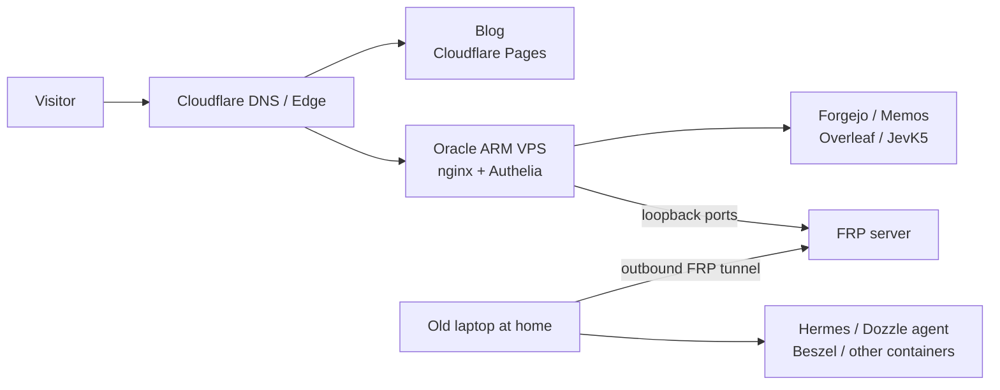

# One month, two machines, twenty repositories

Last month my commit history looked less like a blog and more like a small datacenter.

It started with a 2016 Lenovo Xiaoxin Air 13. No screen, half a keyboard, Ubuntu 26.04, sitting in a corner running Docker. It ended with two machines, more than twenty containers, and twenty repositories with commits this month. No funding, no roadmap, just a concrete annoyance: I did not want my school network to decide whether my services loaded.

## The tunnel stopped being reliable

Everything self-hosted used to leave the house through a Cloudflare Tunnel. It is a good design: no inbound ports, automatic certificates, Cloudflare at the edge. But it assumes a stable path from the house to Cloudflare's edge.

Over the past few weeks, TLS connections from the campus network to that edge started failing intermittently. The awkward part was that the tunnel itself was healthy and the services were alive. I just could not open them from a classroom or a lab. Every debugging session became a defence of a metric that had nothing to do with the user experience.

So I made the most important decision of the month: move the public entry point out of the house and onto an Oracle ARM VPS. Cloudflare still handles DNS and the edge, and the blog still lives on Cloudflare Pages. But the origin for every self-hosted service is now a four-core ARM box in Osaka.

The laptop at home no longer needs to be visible from the internet. It opens an outbound FRP connection to Oracle and reverse-maps its loopback ports for Hermes, the Dozzle agent, and Beszel. Nginx on Oracle routes by hostname, and Authelia handles login for the administrative services. The home connection is now only responsible for keeping the machine online. The public entry point is a small, replaceable component.

The important part of that diagram is not Oracle. It is the direction of the arrows. Both machines only make outbound connections, and the public internet never needs to know where home is.

## One entrance, very few moving parts

Once the entry point moved, the first job was not to install something new. It was to write down who is allowed in.

Nginx on Oracle is now the only web entrance. Each subdomain has a thin vhost that forwards to a port on 127.0.0.1. Content services such as Forgejo, Memos, LMS, and Overleaf keep their own application-level accounts. Administrative surfaces such as Dozzle, Hermes, and the monitoring dashboard sit behind Authelia, which denies by default and asks for a second factor after login. Most services bind only to loopback, so a mistaken nginx rule cannot put the Docker socket or a database directly on the internet.

None of this is novel. It is almost boring. That is exactly what an entrance should be: short config, few dependencies, and a problem you can locate in five minutes. I changed tunnels, certificates, and reverse proxies this month. The one thing I did not change was the rule that the entrance only does entrance work.

## What actually went in

Laid out by service, the month looks like this:

| Service | Where | What changed this month |
| --- | --- | --- |
| [Forgejo](https://git.vedaru.cn/Vedaru/forgejo) + Actions runner | Oracle + home | Forked upstream for the Projects REST API; one runner on each machine |
| [CI images](https://git.vedaru.cn/Vedaru/ci-images) | Local images | Baked Flutter, Rust, Node, Go, and C/C++ toolchains into the runner image |
| [Memos](https://git.vedaru.cn/Vedaru/memos) | Oracle | Forked a TOTP build and moved the diary off the blog |
| [Overleaf CE](https://git.vedaru.cn/Vedaru/overleaf-custom) | Oracle | Running on ARM64, with a dark theme, settings switcher, and dark PDF preview |
| [Dozzle](https://git.vedaru.cn/Vedaru/dozzle) | Oracle + home | A fork with the cloud features removed, aggregating logs from both machines |
| Hermes | Home | Agent plus WebUI, wired to Forgejo/GitHub, gated by Authelia |
| [JevK5](https://git.vedaru.cn/Vedaru/jev-project) | Oracle | A CPU-only 4B decision model and a browser agent driven by it |
| [LMS](https://git.vedaru.cn/Vedaru/lms) | Oracle + home | Theme and template customisation for the music library |
| Minecraft | Oracle | Forge 26.2, for friends |
| Beszel | Home + two agents | CPU, memory, disk, and container visibility |

The time did not go into `docker compose up`. It went into the small questions behind every service: why is it here, and what happens when it breaks?

I forked [Forgejo](https://git.vedaru.cn/Vedaru/forgejo) this month. Not to change the interface, but because upstream does not expose the Projects API I needed. The rule is to rebase on upstream releases, not to patch a tarball. [CI images](https://git.vedaru.cn/Vedaru/ci-images) had the same shape of problem. Every push used to download a 1.5 GB Flutter SDK inside the job. One `oh-my-mc` push ran three jobs, and each one paid the same cost. Baking the toolchain into a `ci-runner` image means a job starts ready to compile. It added no features, but it turned the wait from "go make tea" into "refresh the page".

::forgejo{repo="Vedaru/forgejo" license="GPL-3.0"}

The [Memos](https://git.vedaru.cn/Vedaru/memos) fork is smaller: TOTP and nothing else. The [Overleaf](https://git.vedaru.cn/Vedaru/overleaf-custom) fork lives entirely at the deployment layer. It does not touch the source tree; it bind-mounts a theme, templates, and an nginx config over the image, then re-runs `install.sh` after an upgrade. That boundary matters. Without it, the next upstream release becomes an archaeology project.

## A 4B model on four ARM cores

The most toy-like and most interesting project of the month was [JevK5](https://git.vedaru.cn/Vedaru/jev-project).

Oracle has no GPU, only four ARM cores and 23 GB of RAM. I did not want a model that writes essays. I wanted a small model that answers multiple-choice questions: give it a state and a few candidate actions, and it returns a probability for each option. llama.cpp only evaluates the prompt and returns the log-probabilities of the answer letters. It never generates free text. A thin API wraps that into `/v1/systemone`.

The model is JevK5 4B in Q8_0 GGUF. One result was counter-intuitive: on this aarch64 CPU, Q8_0 is faster than the smaller Q5_K_M and Q4_K_M files. llama.cpp ships a repacked GEMM kernel for Q8_0 on aarch64, while Q5 and Q4 fall back to a per-token GEMV path. Q8_0 processes a prompt at roughly 35 tokens per second. Q5_K_M sits around 22, and Q4_K_M stays below Q8_0 even on longer prompts. The memory saved by the smaller quant was paid back in latency.

On top of that model I built a browser agent. [Obscura](https://git.vedaru.cn/Vedaru/obscura) opens pages with Rust and V8, the model picks one of roughly eight described actions, and it never writes a selector or a line of free text. It can solve a small task such as finding `robots.txt`, and every hesitant step stays in the trace. The design is not general. It is legible and cheap.

## The blog was the biggest project

From the outside, the blog looks like it just gained a few posts. In reality, [vedarublog](https://github.com/Vedaru/vedarublog.github.io) took 145 commits this month, 78 of them not automated chores. Most of the work is invisible.

The largest piece was bilingual routing. Chinese now lives under `/zh/`, English under `/en/`, and content exists in paired `.zh.md` and `.en.md` files. Navigation, archive, diary, anime, albums, search, and RSS all follow the locale. Switching language cannot drop the current page. Turning a Chinese-only static blog into two languages over one component tree is much harder than adding translation strings, especially for islands that only learn their language after client-side hydration.

The second piece was search. Pagefind is gone. It is replaced by a bigram MiniSearch index built by the site itself. I wanted more control over Chinese tokenisation, a faster first load, and one fewer build dependency. The index is generated at build time and prefetched only when needed, instead of being assembled on hover. That change came with its own bugs: search island hydration, non-article pages missing from the index, and the friends page needing to stay searchable. Each one deserves its own post. This is just the receipt.

The third piece was subtraction. The diary moved to Memos, so the blog no longer maintains its own timeline backend. Duplicate pages and components were deleted. CSS animations moved off layout properties and onto transform and opacity, so the home slide no longer forces the compositor to rebuild layers. The non-content diff this month was +15k / -25k. More was deleted than added, which is usually healthy for a personal site.

## Desktop work did not stop

Outside the infrastructure, a few other projects moved:

- **[bili-tui](https://git.vedaru.cn/Vedaru/bili-tui)**: a Rust TUI for Bilibili live streaming. This month was mostly the face-check lifecycle during a stream, detecting a dead danmaku WebSocket, and pulling the palette and focus states into one system.
- **[Kuro](https://git.vedaru.cn/Vedaru/kuro)**: a native Linux installer and updater for Wuthering Waves and Punishing: Gray Raven. No Wine. It applies Kuro's KrDiff patches in Rust, with MD5 verification, resumable downloads, and quality-pack management.
- **[Hyprland](https://git.vedaru.cn/Vedaru/Hyprland) / [HyprCapture](https://git.vedaru.cn/Vedaru/HyprCapture)**: a patch for the input-method candidate popup in Hyprland, plus more work on the screenshot tool.
- **[oh-my-mc](https://git.vedaru.cn/Vedaru/oh-my-mc) / [linear-cli-rs](https://git.vedaru.cn/Vedaru/linear-cli-rs) / [splayer-audio-engine](https://git.vedaru.cn/Vedaru/splayer-audio-engine)**: a Flutter Minecraft launcher, a Rust Linear CLI, and a Rust audio engine extracted from a player so it can be built and released on its own.

These look unrelated to a private cloud, but they share the same machinery: Forgejo repositories, CI runners, and pre-baked images.

## The numbers, and what is still missing

Compressed into numbers:

- 2 always-on machines: a 4-core / 23 GB ARM VPS and a 4-thread / 6.8 GB old laptop
- More than 20 Docker containers
- 20 repositories with commits
- 145 blog commits, 78 of them not automated
- One entry-point migration, from Cloudflare Tunnel to nginx + FRP on Oracle
