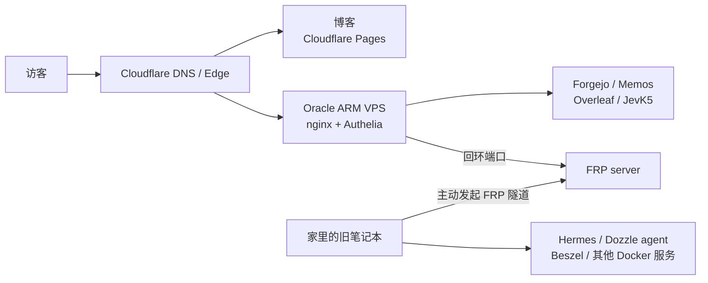

# 一个月，两台机器，二十个仓库

过去一个月，我的提交记录不太像在写博客，更像在给自己造一间机房。

起点是一台 2016 年的 Lenovo 小新 Air 13。它没有屏幕，键盘也半残，装着 Ubuntu 26.04，靠在角落里跑 Docker。终点是两台机器、二十多个容器，以及二十个在这个月有提交的仓库。中间没有融资，也没有 KPI，只有一个很具体的问题：我不想再让学校网络决定我的服务能不能打开。

## 起点：Cloudflare Tunnel 不再可靠

之前所有自建服务都从家里那台笔记本通过 Cloudflare Tunnel 出去。这个方案很优雅：不开放入站端口，证书自动，Cloudflare 负责边缘。但它有一个前提，家里到 Cloudflare 边缘的链路要稳定。

过去几周，学校网络到 Cloudflare 边缘的 TLS 连接开始间歇性失败。尴尬的地方在于，Tunnel 本身是健康的，服务也活着，只是我在教室或实验室里打不开。每次排障都像在证明一个和实际体验无关的指标。

于是我做了这个月最重要的一个决定：把公网入口从家里搬到 Oracle 的 ARM VPS。Cloudflare 继续负责 DNS 和边缘，博客继续放在 Cloudflare Pages；但所有自建服务的源站，改成那台在 Osaka 的 4 核 ARM 机器。

家里的笔记本不再需要被公网直接看见。它主动通过 FRP 连到 Oracle，把 Hermes、Dozzle agent、Beszel 这些回环端口反向映射过去。Oracle 上的 nginx 按域名转发，Authelia 负责管理类服务的登录。这样，家宽只负责“把机器连上网”，公网入口变成一个可以随时替换的、很小的部件。

这张图里最重要的不是 Oracle，而是方向：两台机器都只主动向外连接，公网不需要知道我家在哪里。

## 把入口收成一条线

入口搬过去之后，第一件事不是装新服务，而是把“谁能从外面进来”写清楚。

Oracle 上的 nginx 现在是唯一的 Web 入口。每个子域名对应一个很薄的 vhost，转发到 127.0.0.1 上的某个端口。Forgejo、Memos、LMS、Overleaf 这些内容型服务按各自的应用层账号访问；Dozzle、Hermes、监控面板这类管理界面走 Authelia，默认拒绝，登录后还要过 two-factor。服务本身大多只绑定回环地址，哪怕 nginx 配错了，也不至于直接把 Docker socket 或数据库暴露到公网。

这套东西不新，甚至有点无聊。但“无聊”正是入口应该有的样子：配置文件短、依赖少、出问题能在五分钟内定位。过去一个月我换过隧道、换过证书、换过反代，唯一没换的是“入口只做入口”这个原则。

## 这一个月到底装了什么

把提交记录按服务摊开，大概是这些：

| 服务 | 位置 | 这个月做了什么 |
| --- | --- | --- |
| [Forgejo](https://git.vedaru.cn/Vedaru/forgejo) + Actions runner | Oracle + 家里 | fork 上游，补上 Projects REST API；两台机器各跑一个 runner |
| [CI images](https://git.vedaru.cn/Vedaru/ci-images) | 本地镜像 | 把 Flutter、Rust、Node、Go、C/C++ 工具链烤进镜像，避免每个 job 重装 |
| [Memos](https://git.vedaru.cn/Vedaru/memos) | Oracle | fork 出带 TOTP 的版本，把日记从博客迁过来 |
| [Overleaf CE](https://git.vedaru.cn/Vedaru/overleaf-custom) | Oracle | 在 ARM64 上跑起来，补了暗色主题、设置页切换和暗色 PDF |
| [Dozzle](https://git.vedaru.cn/Vedaru/dozzle) | Oracle + 家里 | 去掉云功能的 fork，聚合两台机器的容器日志 |
| Hermes | 家里 | agent + WebUI，工作区接到 Forgejo/GitHub，外面套 Authelia |
| [JevK5](https://git.vedaru.cn/Vedaru/jev-project) | Oracle | CPU-only 的 4B 决策模型，加一个由它驱动的浏览器 agent |
| [LMS](https://git.vedaru.cn/Vedaru/lms) | Oracle + 家里 | 主题和模板定制，给音乐库换了一套配色 |
| Minecraft | Oracle | Forge 26.2，给朋友用 |
| Beszel | 家里 + 两台 agent | 看 CPU、内存、磁盘和容器状态 |

真正花时间的不是 `docker compose up`，而是每个服务后面那一小块“为什么它在这里、坏了怎么办”。

[Forgejo](https://git.vedaru.cn/Vedaru/forgejo) 这个月被我 fork 了。不是为了改界面，而是上游没有我需要的 Projects API。做法是跟着 release rebase，而不是给 tarball 打补丁。[CI 镜像](https://git.vedaru.cn/Vedaru/ci-images) 也是同一类问题：原来每次 push 都要在 job 里重新下载 1.5GB 的 Flutter SDK，跑一次 `oh-my-mc` 的构建，三个 job 各装一遍。把工具链烤进 `ci-runner` 镜像之后，job 启动就能直接编译。这个改动没有增加任何功能，但把等待时间从“去泡杯茶”变成了“刷新一下”。

::forgejo{repo="Vedaru/forgejo" license="GPL-3.0"}

[Memos](https://git.vedaru.cn/Vedaru/memos) 的 fork 更小，只加了 TOTP。[Overleaf](https://git.vedaru.cn/Vedaru/overleaf-custom) 的 fork 则完全在部署层：不改源码，只把主题、模板和 nginx 配置 bind mount 进去，升级时重新跑一次 `install.sh`。这条边界很重要，否则下一次上游升级就会变成考古。

## 把 4B 模型塞进 4 核 ARM

这个月最像“玩具”，但也最有意思的，是 [JevK5](https://git.vedaru.cn/Vedaru/jev-project)。

Oracle 没有 GPU，只有 4 核 ARM 和 23GB 内存。我想要的也不是一个会写作文的聊天模型，而是一个能做选择题的小模型：给它一段状态和几个候选动作，它返回每个选项的概率。llama.cpp 只负责算 prompt 和输出 token 的 log-probability，不生成自由文本；上面再套一层很薄的 API，把这个能力包装成 `/v1/systemone`。

模型是 JevK5 4B 的 Q8_0 GGUF。这里有个和直觉相反的结论：在这颗 aarch64 CPU 上，Q8_0 比更小的 Q5_K_M、Q4_K_M 更快。原因是 llama.cpp 给 aarch64 的 Q8_0 准备了 repacked GEMM kernel，而 Q5/Q4 会掉到逐 token 的 GEMV 路径。Q8_0 的 prompt processing 大约是 35 tok/s，Q5_K_M 只有 22 左右，Q4_K_M 即使换到长 prompt 也仍然低于 Q8_0。省下的内存，最后都还给了等待时间。

在这个模型上面，我还搭了一个浏览器 agent：[Obscura](https://git.vedaru.cn/Vedaru/obscura) 负责用 Rust/V8 开无头页面，模型只从页面上抽出的 8 个左右候选动作里选一个，不写 selector，也不写自由文本。它在“找 robots.txt”这种小任务上能走对，而且每一步的犹豫都留在 trace 里。这个设计不追求通用，只追求可解释和便宜。

## 博客本身，才是这个月最大的工程

如果只看页面，博客这个月好像只是多了几篇文章。实际上，[vedarublog](https://github.com/Vedaru/vedarublog.github.io) 有 145 个提交，其中 78 个不是自动更新。大部分工作发生在看不见的地方。

最大的一块是双语。现在中文在 `/zh/`，英文在 `/en/`，内容按 `.zh.md` / `.en.md` 成对存在。导航、归档、日记、番剧、专辑、搜索、RSS 都要跟着 locale 走，语言切换也不能把当前页面丢掉。把一个静态博客从“只有中文”改成“两套语言共用一套组件”，比加几个翻译字符串麻烦得多，尤其是那些在客户端 hydration 之后才决定语言的 island。

第二块是搜索。之前用 Pagefind，后来换成了自己构建的 bigram MiniSearch 索引。原因不复杂：我想要对中文更可控的分词、更快的首屏，以及不依赖一个额外的构建步骤。现在的索引在构建时生成，页面只在需要时预取，不再在 hover 的时候现场构建。里面还踩了几个坑：搜索 island 的 hydration、非文章页面的索引、friends 页面的可检索性。每一个都值得单独写一篇，但这里先记一笔。

第三块是减法。日记搬去了 Memos，博客不再维护一套自己的时间线后端；一些重复的页面和组件被删掉；CSS 动画从 layout 属性改成 transform/opacity，首页滑动时不再让 compositor 反复建层。这个月与内容无关的 diff 是 +15k / -25k，删除比新增多。对一个个人站点来说，这通常是好事。

## 桌面端也没有停

基础设施之外，这个月还有几个项目在推进：

- **[bili-tui](https://git.vedaru.cn/Vedaru/bili-tui)**：Rust 写的 B 站直播 TUI。这个月主要修的是直播中的 face check 生命周期、弹幕 WebSocket 假死检测，以及把配色和焦点状态收成一套。
- **[Kuro](https://git.vedaru.cn/Vedaru/kuro)**：原生 Linux 的鸣潮 / 战双安装器和更新器。不依赖 Wine，直接用 Rust 合并 Kuro 的 KrDiff 补丁，带 MD5 校验、断点续传和质量包管理。
- **[Hyprland](https://git.vedaru.cn/Vedaru/Hyprland) / [HyprCapture](https://git.vedaru.cn/Vedaru/HyprCapture)**：给 Hyprland 打了一个输入法候选框的补丁，截图工具也在继续修。
- **[oh-my-mc](https://git.vedaru.cn/Vedaru/oh-my-mc) / [linear-cli-rs](https://git.vedaru.cn/Vedaru/linear-cli-rs) / [splayer-audio-engine](https://git.vedaru.cn/Vedaru/splayer-audio-engine)**：分别是 Flutter 的 Minecraft 启动器、Rust 的 Linear CLI，以及从播放器里抽出来的 Rust 音频引擎。

这些东西看起来和“私人云”无关，但它们共享同一套东西：Forgejo 仓库、CI runner、以及预烘焙镜像。

## 数字，和还没做完的事

把一个月压缩成几个数字：

- 2 台常驻机器：一台 4 核 / 23GB 的 ARM VPS，一台 4 线程 / 6.8GB 的旧笔记本
- 20 多个 Docker 容器
- 20 个仓库有提交
- 博客 145 个提交，78 个非自动提交
- 一次入口迁移，从 Cloudflare Tunnel 改成 Oracle 上的 nginx + FRP
