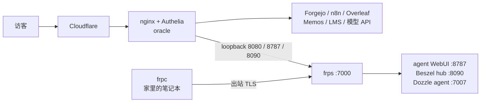

# 两台机器，24 个容器，零 SaaS

这就是我云端的全部家当：一台 4 核 ARM VPS，一台放在家里的笔记本。两台机器跑着 24 个容器，对外服务 13 个域名，托管着我的 Git forge、CI、自动化、笔记、LaTeX、音乐库、一个 Minecraft 世界和一个语言模型。关键路径上没有一项是订阅制。

## 两台机器

| | oracle | laptop |
| --- | --- | --- |
| **角色** | 边缘、forge、CI、模型、大多数服务 | 家庭节点：自动化桥、第二 CI 架构、本地应用 |
| **CPU** | 4 vCPU aarch64 | 4 核 amd64 |
| **内存** | 23 GB | 6.8 GB |
| **磁盘** | 193 GB SSD（已用 74 GB） | 233 GB NVMe（已用 89 GB） |
| **系统** | Ubuntu 26.04 LTS，内核 7.0.0-1009-oracle | Ubuntu，已运行 17 天 |
| **容器** | 17 | 7 |
| **暴露方式** | 通过 Cloudflare 公网可达 | 无，只通过 FRP 隧道 |

## 一个边缘入口，一个登录

nginx 是唯一监听 443 的东西，两台机器上的所有服务都由它前置。Cloudflare 终结公网 TLS。Authelia 通过 `auth_request` 挡在面板前面，所以所有不打算公开的东西都只有一个登录入口。

| 域名 | 上游 | 是什么 |
| --- | --- | --- |
| `git.vedaru.cn` | `:3000`（+ `:8787`） | Forgejo |
| `n8n.vedaru.cn` | `:5678` | n8n，在 Authelia 后面 |
| `jev.vedaru.cn` | `:11435` | 模型 API |
| `overleaf.vedaru.cn` | `:8081` | ShareLaTeX 6.3.1（arm64）+ mongo 8.2 + redis 7.4 |
| `memos.vedaru.cn` | `:5230` | 笔记（自己 fork 的版本，带 TOTP） |
| `music.vedaru.cn` | `:5082` | LMS server，19 GB 音乐库 |
| `monitor.vedaru.cn` | `:8090` → 隧道 | Beszel |
| `dozzle.vedaru.cn` / `portainer` | `:8080` | Dozzle，在 Authelia 后面 |
| `hermes.vedaru.cn` | `:8787` → 隧道 | agent WebUI，在 Authelia 后面 |
| `auth.vedaru.cn` | `:9091` | Authelia |
| `paperclip`、`plan` | 自己的应用 | |

每个站点的限制是逐项调的，不是全局一刀切：git 接受 512 MB 的 push，面板 100 MB，模型 API 16 MB。证书靠 `certbot.timer` 自动续期。

## Forge 是重心

Forgejo 20261017.1，用 Go 1.25 构建，跑在我自己维护的镜像上，SQLite，16 GB 数据。28 个仓库，其中五个带 `.forgejo/workflows`。它不只是代码待的地方，还是整个系统读取的中心：Dozzle、memos、LMS、Forgejo 和 n8n 自己的镜像，全都从那个 forge 里的仓库构建。

## 双架构 CI，没有 registry

如果问我哪部分想得最多，就是这里。两个 Forgejo runner，每个架构一个：

| | oracle | laptop |
| --- | --- | --- |
| **Label** | `ubuntu-latest`、`glibc` | `glibc-amd64` |
| **Job 镜像** | `ci-runner:3.47.7-arm64` | `ci-runner:3.47.7-amd64` |
| **容器** | `--cpus=2 --memory=8g`，host network | `--cpus=4 --memory=5g`，host network |
| **并发** | 1 个 job | 1 个 job |
| **缓存** | 开启 | 关闭 |

整条链路里没有任何 registry。每个 job 把镜像直接构建进那台宿主机的本地 Docker daemon（`--load`），runner 的 label 指向本地 tag，并带 `force_pull: false`，于是 job 容器创建时没有任何网络往返，也不需要 `docker login`。发布流程试过，后来删了：它意味着一次 registry 登录，token realm 还要过 Cloudflare，而且每个架构要推 ~8 GB 过一个隧道，只为了一份永远不会在别处被拉取的镜像。

镜像是原生构建的，从不模拟。arm64 镜像的 Flutter 工具链，是靠解包 x64 tarball、换进 arm64 Dart SDK 拼出来的，而这个过程必须跑它自己的二进制，所以只能跑在 ARM 机器上。这条链路检查两遍：`scripts/smoke-test.sh` 在 Dockerfile 里跑一次，CI 的最后一步再在成品镜像里复检一次。工具链钉在 Flutter 3.47.7、Rust 1.98.1。

两个细节很能说明这套设计：没有 `actions/checkout`，因为默认 action 源是 github.com，这两台 runner 都够不到它，克隆就是走 loopback 的普通 `git clone`。另外，流水线用两个静态 job 而不是 matrix，因为解析失败的 `runs-on` matrix 表达式会永远排队，而不是报错。

## 一条隧道，把一台机器变成两台

VPS 上的 frps 在 `:7000` 接受只走 TLS 的隧道连接，并把一小份白名单端口重新绑定到自己的 loopback：8080、8787、2223、7007、8090。笔记本上的 frpc 只映射四样东西：

- 8787 → agent WebUI
- 8090 → Beszel hub
- 7007 → Dozzle agent
- 22 → SSH，落到 2223

这就是全部的戏法：家里的机器没有公网 IP、没有端口转发、没有动态 DNS，却能从边缘访问，和其他服务处在同一套访问边界里。

## 自动化层

两套系统，故意分开。

桥跑在笔记本上，负责我的计划工具和 forge 之间的接口。它的 entrypoint 起三个循环：每 300 秒一次 `linear sync --apply`、一个 webhook 接收器，以及每周的 governor。映射是单向的（`linear:VED` → `forgejo:Vedaru/linear-cli-rs`），按项目分 scope，kuro、forge 镜像和 CLI 仓库各自落到自己的仓库。我在 Linear 里写的 issue，五分钟内就会出现在 forge 里，不用复制任何东西。

governor（决策模型）是我最满意的一块，因为它把职责切得很清楚：模型判断，代码执行预算。它读取团队里所有 open issue，问本地 3B 模型每个 issue 该怎么处理，然后关掉价值最低的那些，直到数量降到 30 或以下。规则写在 policy 里，不在 prompt 里：

- 最多 30 个 open issue
- 只有聚合关闭概率 ≥ 0.75 才关
- 每次最多关 10 个
- 处于 In Progress/In Review、带 `keep`/`pinned`/`security`/`roadmap`/`blocked-on-user` 标签、或最近 7 天有更新的 issue 豁免
- 候选只限于项目已经 canceled 或 completed 的 issue

一次真实的 dry run：open 39，cap 30，超出 9 → 选中 9 个，保护 28 个，shortfall 0，被选中的 issue 置信度在 0.96–0.97。每个决定都会追加到 JSONL 审计文件，外加一份人可读的 plan。代码本身也是一个仓库，[`Vedaru/linear-decider`](https://git.vedaru.cn/Vedaru/linear-decider)，带 `container/`、`systemd/` 和 `tests/`，所以 policy 和其他东西一样有版本。

n8n 是更新的那一半：2.45.0，跑在自己的镜像上，在 Authelia 后面，SQLite 放在 `/srv/n8n-data`。clean task 现在也存在于那里，是一个 13 节点的 workflow：webhook 和每周 schedule 触发器、Linear GraphQL 读数据、每个 issue 一次模型调用、一个持有同一份 policy 的 Code 节点，然后是带保护的 mutation，以及作为 webhook 响应返回的 markdown 报告。默认 dry，只有生产运行才 apply。两个 issue 端到端：102 秒。

## 家里的模型

Ollaya 0.17.0 在 llama.cpp 上服务 `d1:3b` Q8_0，2.7 GB 权重，和所有东西跑在同一台 VPS 上。三个线程，限制在 3.5 CPU 和 12 GB，30 分钟 keep-alive，免得每个问题都重新加载。测过第四个线程，只多买到约 15%（每个请求 52 s → 43 s），然后回滚了，因为它会在每个请求的整个持续时间里再占掉其他容器一个核。边缘通过 loopback 访问它，容器通过 Docker bridge gateway 访问它，两种方式都要 API key。

每次调用边际成本为零，governor 一轮问 30 个问题也不用看账单，旁边那套 agent（`jevk5-agent`、`jevk5-obscura-mcp`）也用同一个模型来浏览和调工具。

## 配角

Memos 记笔记，Overleaf 写论文，LMS 放音乐，itzg Minecraft 服务器在 25565，Dozzle 看日志（manager 在 VPS，agent 在笔记本），Beszel 看指标（hub 在笔记本，agent 两边都有），sing-box 做路由，Authelia 管身份。所有容器都是 `restart: unless-stopped`，三个有状态的（mongo、redis、ShareLaTeX）是 `always`，那些可能咬人的服务用资源上限管住，而不是靠信任：Ollaya 3.5 CPU / 12 GB，浏览 MCP 1 CPU / 1 GB，agent 0.5 CPU / 256 MB，CI runner 0.5 CPU / 512 MB。

## 为什么这样更快

不是感觉，是机制：

- **Push 就是部署原语。** CI 在匹配的架构上构建，直接进将要运行容器的那个 daemon，`force_pull: false` 让下一次启动完全不需要网络。
- **没有 registry，没有 auth，没有限流。** 链路里没有任何一环会被第三方限速，任一架构的镜像都只差一次 push。
- **原生硬件上原生构建。** ARM job 在 ARM 机器，AMD64 job 在笔记本，Flutter 工具链不交 QEMU 税。
- **一个边缘入口、一个登录**，管两台机器和十三个域名。
- **计划和代码是同一套系统。** 镜像每五分钟跑一次，issue 和仓库不会分叉。
- **面板已经在了。** 日志和指标就是一个 URL，在同一个 SSO 后面。

## 为什么这样能自动运行

每个循环都有节奏和护栏，这才让放着不管变得合理：

| 循环 | 节奏 | 护栏 |
| --- | --- | --- |
| Linear → Forgejo 镜像 | 300 s | 单向映射，按项目分 scope |
| Backlog governor | 每周 | cap 30 · ≥0.75 置信度 · ≤10/次 · 受保护状态/标签/最近更新 |
| CI 构建 + 验证 | push 时 | 构建内 smoke test，成品镜像里复检 |
| Clean task（n8n） | 每周 / webhook | 默认 dry，只有生产运行才 apply |
| 证书 | `certbot.timer` | 自动续期 |
| 容器 | 始终 | restart policy + healthcheck |

大概就是这个形状：两台机器，二十四个容器，一个 forge，一个登录，一条通往家里那台机器的隧道，以及一个安静地防止 backlog 增长得比我关得还快的小模型。
